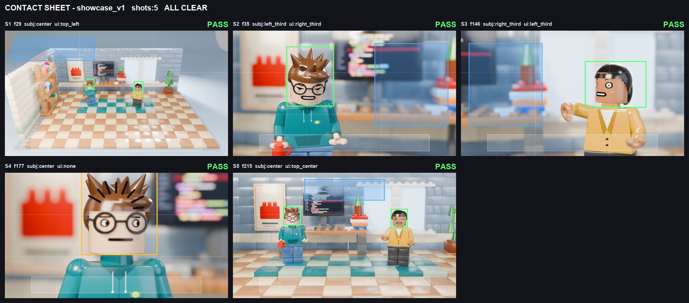
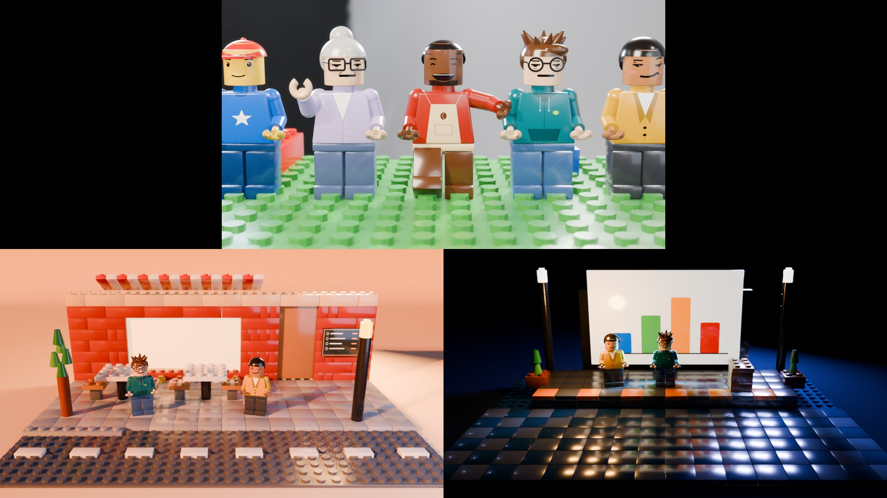

# LegoStudio

A local-first film studio for **brick-stylized comedic explainer videos**: minifigures with crisp **2D sprite faces** acting in logo-free
brick dioramas (Blender 5.2, EEVEE on GPU), with **instruction-manual motion graphics** layered on top (Remotion), plus offline TTS, automatic 2D lip-sync,
procedural SFX and music, and an FFmpeg master compositor.

The AI writes only a small JSON shotlist. Everything heavy runs on your machine at zero API cost.



## Quick start
```bash
git clone https://github.com/hwngbob420/LegoStudio && cd LegoStudio
python bootstrap_studio.py                    # audit + HDRIs + generated textures + Remotion deps
python engine/produce.py productions/showcase_v1
```
Output: `productions/showcase_v1/output_final.mp4` (1920×1080, 60 fps, AAC).

Requirements: Windows 10/11 (SAPI voices), Blender 5.1+ (tested 5.2.3 LTS), Python 3.10+ with numpy and Pillow, Node 20+, and an FFmpeg full build.
An NVIDIA GPU is recommended (tested on an RTX 3060 12 GB).

## New episode
1. Create `productions/<ep>/script.json` (lines and speakers) and `episode_shotlist.json` (shots, cameras, expressions, UI cues).
   Or, in Claude Code, run `/produce <ep> "<your idea>"` and the 01-showrunner agent writes both from `vault_config/catalog_manifest.json`.
2. Run `python engine/produce.py productions/<ep>`.

Stages: `tts → lipsync → props → contact (QA gate) → render → audio → overlay → composite → qa → clean`. Resume with `--from <stage>`.

## What's inside
| Area | What it does |
|---|---|
| `engine/brick_builder.py` | Procedural bricks, plates, tiles, rounds and cones with plain studs (no logos), micro-bevel and seams. Instanced meshes. `.ldr` export |
| `engine/sets_library.py` | Three dressed sets: **Set_BrickCreatorDesk**, **Set_BrickCafeStreet**, **Set_BrickOfficeStage**, with stage anchors and assembly steps |
| `engine/minifig_builder.py` | Procedural minifigure (legs, hips, torso print, arms, C-hands, cylinder head, hair styles, glasses) on a 10-bone rig (6 joint groups) |
| `engine/acting_library.py` | 15 stop-motion gestures (talk, point, shrug, shock jump, sip coffee, walk...) baked per frame on twos, with puppet "boil" |
| `engine/look_dev.py` | ABS plastic shader (coat, subsurface), 2D face shader driven by object props, HDRI and key/fill/rim presets |
| `engine/fx_library.py` | Grease Pencil v3 emotion FX: sweat drop, shock lines, ?, !, sparkle, anger, steam |
| `engine/stage_compiler.py` | Shotlist → scene: sets, cast, acting, faces, lip-sync, assembly transition, cameras/markers, DoF, shake |
| `engine/tts_sapi.py`, `lipsync_2d.py` | Offline SAPI TTS with viseme and word events (audio-calibrated), quantised to 12 fps mouth tracks. Optional Rhubarb |
| `engine/contact_sheet_gen.py` | One-image QA gate with safe-zone boxes and an automatic face-vs-UI collision check over sampled frames |
| `engine/audio_design.py` | Procedural ABS clacks, pops, whooshes, a brick tumble and a ukulele/marimba music bed, ducked under VO |
| `remotion_studio/` | Transparent overlay: STEP badges, part-count callouts, stacked-brick bar chart with collapse, hand-drawn arrows, word-synced subtitles |
| `engine/master_compositor.py` | 12 fps plate held 5× → 60 fps, grain and vignette, VP9-alpha overlay, mix → H.264 MP4 |
| `.claude/` | 5 sub-agents, 4 skills, 4 slash commands (`/produce`, `/cast-minifig`, `/build-brick-set`, `/studio-doctor`) |



## Starter cast
Max (tired dev), Priya (smug team lead), Kofi (barista philosopher), Grandma Lin (retired engineer) and Bricky (classic yellow narrator).
Each is a JSON recipe in `vault_config/minifig_recipes/`.

## Brand safety
All studs are plain, and rendered frames contain no trademark words or logos. Posters, screens and torso prints are text-free.
This project is not affiliated with or endorsed by the LEGO Group.

## Docs
`PROJECT_BLUEPRINT.md` (architecture and integration status) · `CLAUDE.md` (agent rules) · `OPTIMIZATION_LOG.md` (benchmarks).
