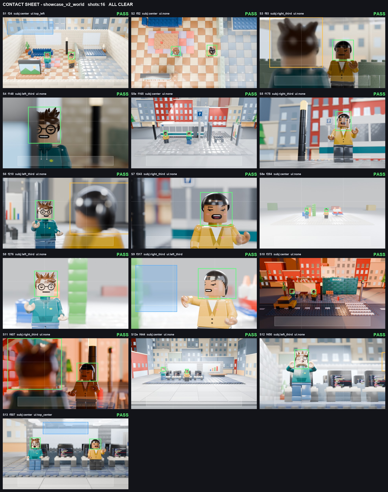

# LegoStudio (Lego Studio Engine v2)

Studio làm video giải thích hài **phong cách mô hình gạch 3D**, chạy hoàn toàn trên máy Windows của bạn. Minifig có **gương mặt 2D**
đổi biểu cảm tức thì, bộ set gạch không logo, chữ và biểu đồ kiểu sách hướng dẫn lắp ráp.
Quy trình làm theo mô hình **pixel-story-engine**: gửi outline → Claude viết JSON → sửa trong Studio 6 tab → xuất video.



## Bắt đầu
1. Cài **Node.js LTS**, **Python 3.10+**, **Blender 5.2**, **FFmpeg** (bản đầy đủ).
2. Bấm đúp **`start.bat`**. Lần đầu nó tự cài thư viện và chuẩn bị tài nguyên, rồi mở Studio ở http://localhost:5174.
3. AI viết kịch bản là **Claude Code** trên máy bạn (dùng tài khoản Claude, kèm skill `screenwriter` của dự án). Lần đầu, hoặc khi Studio báo
   "chưa đăng nhập", mở Terminal và gõ `claude auth login`. Muốn trả lời thủ công trong phiên Claude Code thì đặt `AI_SESSION_QUEUE=1` trong `.env` (Hộp thư Claude).
   Gemini chỉ dùng khi đặt `AI_PROVIDER=gemini` trong `.env`.

## Studio 6 tab
| Tab | Làm gì |
|---|---|
| **Kịch bản** | Gửi file outline (.docx, .pdf, .md, .txt, .fountain) hoặc dán truyện, chọn ngôi kể, giọng văn (16 kiểu), độ dài (20 giây – 30 phút), thông điệp → **Làm bản xem trước**: Claude lập dàn ý, viết thoại theo từng block ~2 phút, rồi tự tạo giọng và dựng hình (chạy nền), xong tự mở tab Duyệt block. "Chỉ viết kịch bản" nếu chỉ cần chữ |
| **Duyệt block** | Tập chia block ~2 phút. Mỗi block: Player 3D xem riêng, lời thoại (bấm để nghe), nhận xét tự động (code + Claude tự chấm), ô góp ý gắn theo câu/cảnh, **Claude sửa block này** (chỉ block đó đổi, câu không đổi giữ giọng cũ), **Duyệt block**, xem bản render cuối của block |
| **Xưởng** | Ráp minifig xoay 3D (da, tóc, áo in, phụ kiện, giọng), vai quần chúng ngẫu nhiên, Lưu sang kho kênh, sơ đồ tập dạng nút |
| **Giọng đọc** | Tạo giọng trên máy, hoặc nạp giọng thật từng câu rồi **Tự khớp giờ** bằng Whisper; khẩu hình 2D tự sinh |
| **Đạo diễn & Xem trước** | **AI tạo Storyboard**; Player 3D xem ngay (Three.js); sửa thẻ cảnh (góc máy, biểu cảm, động tác, hiệu ứng); lỗi "thẻ chữ che mặt" hiện tức thì; **Kiểm khung** bằng Blender |
| **Xuất bản** | Render bản cuối bằng Blender EEVEE theo từng block (block không đổi được dùng lại, tắt máy vẫn làm tiếp được), mỗi block ra một video riêng rồi ghép thành bản cuối, **phụ đề đa ngôn ngữ**, **Shorts dọc 1080x1920**, sổ chi phí AI |

## Kiến trúc (phương án C)
- **Một bộ đạo diễn duy nhất** (`packages/director`, TypeScript) tính trước mọi chuyển động thành `baked_timeline.json`.
- **Hai máy chiếu phát lại đúng file đó:** Three.js trong trình duyệt (xem trước tức thì) và Blender EEVEE (bản cuối, chất 3D cao).
  Hai bên khớp nhau tới 0,000008 khung, có test tự động.

| Thư mục | Nội dung |
|---|---|
| `packages/shared` | Schema zod cho mọi JSON, hằng số, mốc thời gian, căn chữ Whisper |
| `packages/director` | Động tác stop-motion, mặt + khẩu hình, camera đủ thang cỡ cảnh (EWS → CU, qua vai) và góc (thấp, cao, nhìn từ trên), dolly / trượt ngang / cần cẩu, tilt-shift theo cỡ cảnh, dàn cảnh nhiều bối cảnh + cutaway, kiểm "không che mặt" + kiểm bố cục set, lọc đơn điệu hình ảnh, dựng storyboard từ nhịp AI, Shorts |
| `apps/brick-engine` | Python + Blender 5.2: gạch không logo, minifig rig 10 khớp, bộ set 3 vòng (sân diễn + trung cảnh + chân trời + vòm trời), xuất `.glb` + manifest, render theo block, TTS SAPI, âm thanh, ghép FFmpeg |
| `apps/video-engine` | Remotion: lớp chữ hướng dẫn lắp ráp (thẻ STEP, part callout, biểu đồ gạch, mũi tên, phụ đề) + máy chiếu Three.js |
| `apps/server` | Express: API tập/kho/xem trước, hàng đợi việc nền, cổng AI (Gemini + dự phòng + Hộp thư Claude), Whisper |
| `apps/studio-ui` | React + Vite + Tailwind: Studio 6 tab |
| `workspace/channel_library` | Kho kênh: diễn viên, bộ set, gương mặt, ánh sáng, manifest, series bible |
| `workspace/projects/<tập>` | Kịch bản, storyboard, bản dịch, video |

## Thế giới gạch 3 vòng (Gđ 6)
- **10 bộ set** gồm 3 set cũ và 7 set mới khép kín. Bảy set mới:
  - phố góc quán cà phê;
  - căn hộ cắt mái;
  - văn phòng mở;
  - cửa hàng tiện lợi (đèn neon đêm);
  - quảng trường / đài ngắm phố;
  - trạm xe buýt;
  - sân khấu sách hướng dẫn.
- Mỗi set mới có sân diễn chi tiết, trung cảnh, chân trời gạch và vòm trời. Máy quay ở góc nào cũng không lộ mép trống. Trần và tường tự dỡ khi máy chúc cao hoặc nhìn từ trên.
- Biên kịch chọn **bối cảnh + ý đồ hình ảnh** cho từng nhịp. Mỗi block 2 phút đi qua 2–4 nơi. Đạo diễn tự chèn cảnh mở toàn rộng khi đổi nơi và tự dời diễn viên sang set mới.
- Tab Duyệt block có thêm nhận xét **"Hình đơn điệu"**. Nó báo khi cùng một cỡ cảnh quá 22 giây, hoặc cùng bối cảnh và góc máy quá 60 giây.
- Nghiên cứu nguồn mở và quyết định chọn / bỏ: `docs/LAYOUT_RESEARCH.md`. Skill: `brick-world-layout-architect`, `cinematic-camera-blocking`.

## Tập mẫu
- `showcase_v2_world` "The Snooze Commute":
  - 45 giây, 5 bối cảnh, 16 cảnh;
  - đủ thang máy: toàn cực rộng mở cảnh, nhìn từ trên vào căn hộ đã dỡ trần, góc thấp châm biếm, qua vai, cận mặt;
  - có biểu đồ gạch ở sân khấu hướng dẫn.
- `showcase_v1` "Bug Hunt": 19,5 giây, có thêm bản phụ đề tiếng Việt `output_final_vi.mp4`.
- `ep01_foam_physics`: Kofi + Grandma Lin ở phố quán cà phê (storyboard do đạo diễn tự động dựng).
- `ep02_the_to_do_list_trap`: tập dài 3 phút 10 giây, 52 câu, render chia chặng. Trên GitHub chỉ có bản xem trước `output_preview_720p.mp4`
  (bản 1080p60 nặng 125 MB, vượt giới hạn GitHub; chạy `npm run produce` để tự render).
- `showcase_v1_shorts`: bản Shorts dọc 1080x1920 của "Bug Hunt", tạo bằng nút "Tạo Shorts dọc".

## Lệnh cho người dùng nâng cao
```bash
npm test                                                        # 72 test tự động
npm run doctor                                                  # kiểm sức khoẻ môi trường
npm run produce -- workspace/projects/<tập>                     # làm trọn một tập ra output_final.mp4
npm run produce -- workspace/projects/<tập> --from overlay --to composite --lang vi   # chỉ xuất lại phụ đề tiếng Việt
```

## An toàn thương hiệu
Núm gạch trơn, không logo; khung hình không có chữ thương hiệu (hook tự chặn). Dự án không liên quan và không được bảo trợ bởi LEGO Group.

Tài liệu: `docs/MASTER_ADD.md` (đặc tả) · `docs/PROGRESS.md` (tiến độ) · `CLAUDE.md` (luật cho Claude) · `docs/OPTIMIZATION_LOG.md`.
